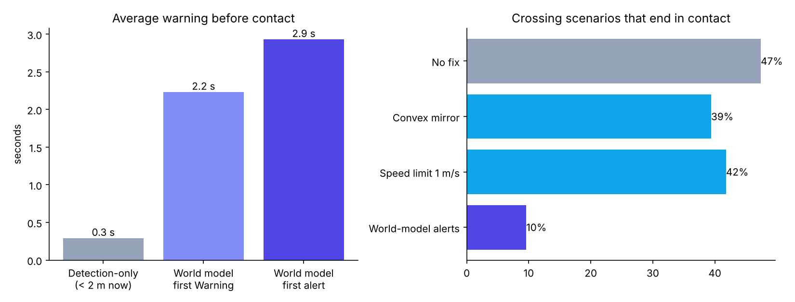

# Industrial World Model

**Warn workers 3–5 seconds before a forklift collision, using the cameras a site already has.**

Hackathon proof of concept by Team Future Frames (Industry & Energy theme).

Today's video AI describes the current frame, so it alerts when danger is already happening.
Industrial World Model tracks every worker and forklift, rolls the scene forward into many
possible futures, and buzzes the worker's phone *before* the paths cross.

```
Camera / Simulation ──► Tracks ──► World model (Kalman + Monte Carlo futures)
                                        │
                                        ▼
                         Alert engine (tiers + hysteresis) ──► MQTT ──► phone buzz
                                        │
                                        ▼
                         Dashboard (Streamlit) + Azure OpenAI incident brief
```

## Status

Built in stages, one commit per stage:

| Stage | What | Status |
|---|---|---|
| 0 | Scaffold: config, data format | done |
| 1 · See | Perception on video + warehouse simulation | done |
| 2 · Predict | World model: Kalman + Monte Carlo collision risk | done |
| 3 · Alert | Alert tiers, MQTT, phone buzz, evaluation | done |
| 4 · Improve | Incident brief, what-if, dashboard | — |

## Data format

Every module exchanges two records (metres, seconds):

```json
{"t": 12.4, "id": "fl_02", "type": "forklift", "x": 14.2, "y": 6.8, "vx": 2.1, "vy": -0.3}
{"t": 12.4, "pair": ["fl_02", "wk_07"], "tier": "warning", "p_collision": 0.68, "ttc_s": 2.7}
```

## Setup

```bash
python -m venv .venv && source .venv/bin/activate   # Windows: .venv\Scripts\activate
pip install -r requirements.txt
```

## Stage 1 · See

```bash
python -m iwm.sim --scenario blind_corner --plot   # top-down run -> runs/sim.png
python calibrate.py --source data/demo.mp4          # click 4 floor markers -> image_points
```

- `iwm/sim.py`: 20 x 12 m warehouse, one blind corner, a forklift and a walker. Emits the same
  track records as the camera, plus the true contact time. Scenarios: `blind_corner`, `crossing`,
  `parallel`, `random`.
- `iwm/perception.py`: YOLOv11 + ByteTrack on video; box bottom-centre mapped to floor metres
  with a homography from 4 taped markers.

## Stage 2 · Predict

- `iwm/worldmodel.py`: a constant-velocity Kalman filter smooths each track and estimates its
  velocity. For every worker-forklift pair, 50 futures are rolled 5 s ahead with noise on speed and
  heading and a chance the walker stops. `p_collision` = share of futures within 1.5 m; `ttc_s` =
  median time of first contact.
- `explain()` re-runs the futures with one factor changed (forklift slows, worker stops, forklift
  stops) and ranks which change lowers risk most.
- `detection_only()` is the baseline we compare against: alert only when a pair is already < 2 m apart.

```bash
pytest -q
```

## Stage 3 · Alert

- `iwm/alerts.py`: Advisory / Warning / Critical tiers with hysteresis (3 rising frames to escalate,
  1 s below a threshold to drop). Alerts go to MQTT topic `iwm/alerts`, `logs/alerts.jsonl`, and a laptop beep.
- `phone.html`: the worker's "wristband". Open on an Android phone, tap Start, and it vibrates on each alert.
- `run_camera.py`: the full live pipeline on real video, with predicted paths drawn on the frame.
- `iwm/evaluate.py`: 1,000 simulated runs, world model vs detection-only, plus what-if fixes.

```bash
mosquitto -c mosquitto.conf -v                      # terminal 1: broker (1883 + WebSocket 9001)
python -m http.server 8000                          # terminal 2: open http://<laptop-ip>:8000/phone.html?broker=<laptop-ip> on the phone
python run_camera.py --source data/demo.mp4         # terminal 3: live demo on real video
python -m iwm.evaluate --runs 1000                  # results -> results/results.json, results/results.png
```

### Results (1,000 simulated runs, 329 with contact)

| | Detection-only (< 2 m now) | World model |
|---|---|---|
| Contacts flagged before they happen | 100% (at the last moment) | 99% |
| Average warning before contact | 0.3 s | 2.2 s (Warning) · 2.9 s (first alert) |
| False alarms per simulated hour | 33 | 16 |

Crossing scenarios that end in contact: **47%** with no fix, 39% with a convex mirror, 42% with a
1 m/s speed limit, and **10%** when the worker and driver react to world-model alerts.



All tunable numbers are in `config.yaml`; Azure keys go in environment variables (see `.env.example`).
