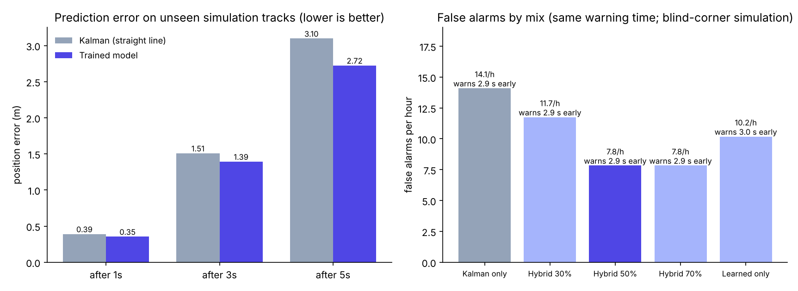

# Hybrid world model (trained + Kalman)

The world model imagines 50 possible futures for every worker and forklift and counts how many end in a
collision. In **hybrid** mode, half of those futures come from a **trained motion model** and half from the
original **Kalman rules**. Collision risk is still "share of the 50 futures that collide", so the alerts,
UI and phone code are unchanged.

```
track history (2 s) ─► trained model ─► 25 futures ─┐
                                                    ├─► 50 futures ─► collision risk ─► alerts
Kalman state ──────► rules (straight line + noise) ─► 25 futures ─┘
```

## Why mix

- **Kalman rules:** reliable, need no data, but assume straight lines.
- **Trained model:** learns real habits (slowing before a corner, stopping, turning), but can be wrong on unusual movement.
- **Mixed:** a confident collision needs both to agree, which cuts false alarms; if the model misbehaves the
  Kalman half keeps the system safe. Short tracks (< 2 s) and a missing model file fall back to Kalman only.

## The trained model (`iwm/learned.py`)

- Input: the last 2 s of the track (Kalman-smoothed), in the object's own heading frame, plus speed and type.
- Output: how the next 5 s **differ from Kalman's straight line** (a residual), plus a learned spread for sampling.
- A small neural network in NumPy (2 hidden layers, Adam). No PyTorch needed; trains in about 30 s on a laptop.

## Results (simulation, `python evaluate_motion.py`)

| | Kalman only | Hybrid 50/50 |
|---|---|---|
| Position error after 5 s (unseen tracks) | 3.10 m | 2.72 m (trained model) |
| False alarms per hour | 14.1 | **7.8** |
| Warning before contact | 2.9 s | 2.9 s |
| Collisions caught early | 98% | 98% |

The simulation moves people in near-straight lines, so the gain there is modest. Real video is where learned
habits matter most: fine-tune on your own tracks and re-run the evaluation with `--real`.



## Train on real video

```bash
# 1. Save tracks from your clips (or tick "Save tracks for training" on the UI Real video page)
python run_camera.py --source data/samples/clip1.mp4 --approx 15 --headless --log-tracks
python run_camera.py --source data/samples/clip2.mp4 --approx 15 --headless --log-tracks

# 2. Pretrain on simulation, fine-tune on the real tracks (short clips: add --history 1 --horizon 3)
python train_motion.py --real "logs/tracks/*.jsonl"

# 3. Compare against Kalman, on simulation and on the real tracks
python evaluate_motion.py --real "logs/tracks/*.jsonl"
```

Tracks need to be at least history + horizon long (7 s by default, 4 s with `--history 1 --horizon 3`).
Calibrated cameras (calibrate.py) give the best results; `--approx` works for downloaded clips.

## Switching modes

`config.yaml` → `world_model.mode: kalman | hybrid | learned` and `learned_share` (0.5 = 50/50). The UI's
Live demo and Warehouse pages have a **World model** switch (Hybrid / Kalman only) to compare live; the
Results page shows the comparison chart.
